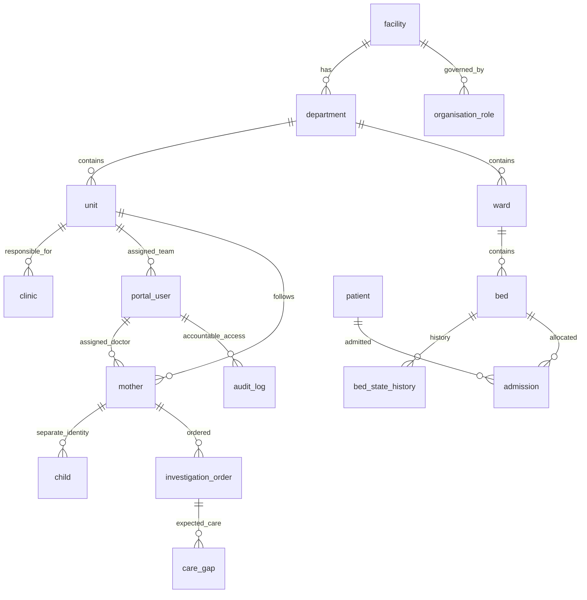

# DAI Hospital & Administration Portal

DAI is a hospital readiness and care-coordination layer. All people, facility identities, registrations and clinical records are **synthetic**. Every screen is labelled **Simulated on synthetic data**. No diagnosis, prescribing or clinical safety decision is automated.

This folder implements the **first phase** of the supplied specification alongside the existing Express prototype. Next.js/TypeScript/Tailwind and FastAPI are the new portal. The existing plain-HTML hospital screen is a separate synthetic administration preview; its header-based demo roles are not secure authentication and it must not receive real data or be publicly deployed.

## Run the new portal locally

From `/Users/Dell/Documents/DAI`, using Python 3.11 and Node 22 or newer:

```sh
python3.11 -m venv hospital_portal/.venv
hospital_portal/.venv/bin/pip install -r hospital_portal/requirements.txt -r synthetic_data/requirements.txt
# Generated databases are local artifacts, not committed to Git.
# Generate the base dataset only when it is absent.
if [ ! -f synthetic_data/output/dai.db ]; then
  hospital_portal/.venv/bin/python synthetic_data/generate.py
fi
hospital_portal/.venv/bin/python synthetic_data/build_hospital_admin.py
DAI_DEMO=true hospital_portal/.venv/bin/python -m hospital_portal.api.seed
DAI_DEMO=true DAI_WEB_ORIGIN=http://localhost:3004 hospital_portal/.venv/bin/uvicorn hospital_portal.api.main:app --host 127.0.0.1 --port 8000
```

In another terminal:

```sh
cd /Users/Dell/Documents/DAI
npm ci --prefix hospital_portal/web
npm run dev --prefix hospital_portal/web -- --port 3004
```

Open `http://localhost:3004`. The local API uses `portal-preview.db` (SQLite), explicitly reported by `/api/health`. This is a preview, not PostgreSQL acceptance. The Next development command uses webpack because this restricted macOS environment cannot start Turbopack's FSEvent stream.

Synthetic demo login: `hospital_admin@dai-synthetic.invalid`, password `Dai-Synthetic-2026!`. Enter the six-digit simulated OTP displayed after password verification. No SMS/email is sent. Explicit `DAI_DEMO=true` is required. API startup requires a fresh `JWT_SECRET` outside demo mode, and production login fails closed until a real OTP delivery adapter is implemented.

The local SQLite database is imported only once. To test a new configuration without altering an existing preview, set `DATABASE_URL=sqlite:////absolute/path/to/a/new-preview.db` consistently for both seed and API. `DAI_SOURCE_DB` can override the source path. Do not point test commands at an existing production database.

## Run the existing hospital administration preview

```sh
cd /Users/Dell/Documents/DAI/backend
npm install
npm run hospital:seed
npm start
```

Open `http://localhost:3001/hospital.html`. Express serves both the API and this plain-HTML frontend; no separate frontend process is needed for that preview. If an older backend is already running on 3001, stop it in its terminal with Ctrl+C and restart so it loads the new administration routes. This preview has demo-only header roles; use the new portal for authenticated access checks. Do not expose the legacy preview publicly.

## Requested Docker stack

Docker is not installed in the current workspace environment, so this configuration has not been executed here.

```sh
cd /Users/Dell/Documents/DAI/hospital_portal
cp .env.example .env
# Replace POSTGRES_PASSWORD and JWT_SECRET in .env with fresh random secrets.
# Use a URL-safe PostgreSQL password because it appears in DATABASE_URL.
docker compose up --build
```

Services: `web`, `api`, `postgres` (PostGIS), `redis`, `ml-service`, `worker`. The API imports the existing read-only `../backend/data/dai-hospital.db`; run the hospital seed builder first. Public host ports bind to loopback. The ML service explicitly returns 501 for predictions, and the worker runs no jobs in this phase. Redis-backed live channels, expiry jobs and forecasting are later-phase work, not represented as working features. S3/report storage is roadmap.

## Source data and relationships

The original `synthetic_data/output/dai.db` and its validation results are preserved. `build_hospital_admin.py` enriches a copy with hospital structure. This portal reads that copy in read-only mode, assigns deterministic UUIDv5 keys, retains every source ID, and records a SHA-256 manifest.

Imported: 12 facilities; 2,000 mothers sampled deterministically from the existing 5,000; 240 mothers already confirmed high-risk by existing synthetic clinicians; 1,078 individual children; 4,127 beds; 20,638 investigation orders; 6,668 source-derived gaps. The complete patient census is retained as minimal patient identity records so occupied beds resolve even for patients outside the detailed mother cohort. Background inpatients are explicitly synthetic.

The unit/ward/doctor assignments come from the same source. No ML inference creates a high-risk flag. New high-risk validation and clinical write workflows are not enabled in Phase 1. `schema.sql` is generated from the actual SQLAlchemy schema. Every table has a UUID primary key and created/updated timestamps. PostgreSQL adds a generated PostGIS geography point and spatial index from longitude/latitude. Core tables for later modules are present but may be empty until that module's seed/import phase.



## Phase gates

The supplied document references a Section 9 phase plan that was not included. The dependency order is recorded in `PHASES.md`. Do not start Phase 2 until the remaining PostgreSQL/PostGIS deployment gate passes.

Phase 1 provides M1 facility edits and department/unit/clinic CRUD; fictional organisation office holders; M2 password + simulated OTP, JWT access sessions, refresh rotation, logout revocation, credential verification API, deny-by-default permissions, facility/unit/assigned-patient filters and read-access audit logging. The demo role switcher requires an administrator-originated session, issues a new signed session, records the switch and revokes the prior session. A separately logged-in nurse cannot switch into admin. Access tokens stay in browser memory; refresh tokens are HttpOnly/SameSite cookies. The server checks current credentials on each access.

Registration, consult links, live bed edits, referrals, clinical completion, second-factor SOS, blood issue, roster approvals, external integrations and ML are not built in this new portal yet. Role home screens show their permissions and permitted navigation; workflow-specific home screens arrive with the corresponding module.

## Validate

```sh
cd /Users/Dell/Documents/DAI
DAI_DEMO=true hospital_portal/.venv/bin/python -m pytest hospital_portal/tests -q
hospital_portal/.venv/bin/python -m hospital_portal.api.export_schema
npm run typecheck --prefix hospital_portal/web
npm run build --prefix hospital_portal/web
npm audit --prefix hospital_portal/web
npm test --prefix backend
python3.11 synthetic_data/validate.py
```

Tests cover source/provenance integrity, clinician-confirmed risk preservation, all mother→unit→doctor facility links, password/OTP/lockout/replay, rotating refresh sessions, denied header spoofing, role permissions, unit isolation, patient read auditing, credential verification, CRUD and prevention of cross-facility references/deletion of linked records. Run `hospital_portal/.venv/bin/python -m hospital_portal.api.acceptance --report hospital_portal/acceptance-report.json` against the preview or a dedicated `DATABASE_URL`. Exit 2 means PostgreSQL deployment acceptance is pending; it deliberately keeps Phase 2 locked. PostgreSQL execution remains separately pending; SQLite tests do not establish PostGIS or multi-worker concurrency correctness.

## Configurable capacity scenario

`config.yaml` stores all proposed anchor targets. Actual imported anchor capacity remains **1,227 authorized / 1,216 functional beds**, based on the validated source. Do not replace it with a cosmetic 1,500 counter: adding capacity requires creating corresponding wards/beds and rerunning relational/census checks.

Before the capacity phase, verify the proposed NMC MSR/IPHS figures, whether 15 HDU beds are included in the 355 OBG total (279+76 already equals 355), NICU/PICU/ventilator counts, the 21-ambulance scenario, and network composition. The imported network has 12 facilities; a separate 7-facility scenario and a third PHC are not silently invented. Twenty-four months of operational training history and operational forecast evaluation are Phase 5 work. No model performance is claimed.


## Operations and Administration workspace

The portal restores both workspace tabs and a fuller sidebar. Existing records now power the ward/bed grid, critical-care census and admission log, blood components, staff establishment and shift rosters, equipment, ambulances, daily admissions/discharges/deliveries/referrals, appointments, derived care gaps, diagnostic orders, referrals and recorded SOS history. The patient registry supports name/source-ID search and pagination. Every view stays scoped by facility/role; clinical worklists also enforce unit/assignment scope and audit patient records returned. An incoming referral may display its mother's identity only to an authorized receiving administrator and is audit-logged.

These operational screens are explicitly **recorded synthetic snapshots, read only**. They do not imply that live reservation, discharge, dispatch, clinical write, or forecast phases have passed. Source records are read from the existing enriched SQLite ledger (`DAI_SOURCE_DB`); this source must remain available alongside the portal database. No extra patient or clinical data is invented to fill a panel.

After upgrading an already running copy, stop and restart the FastAPI terminal once to load `api/workspace.py`. The frontend development server reloads the interface automatically. For future development you can add `--reload --reload-dir hospital_portal/api` to the Uvicorn command. The user-facing snapshot remains 2026-10-20 even when the host date advances.
