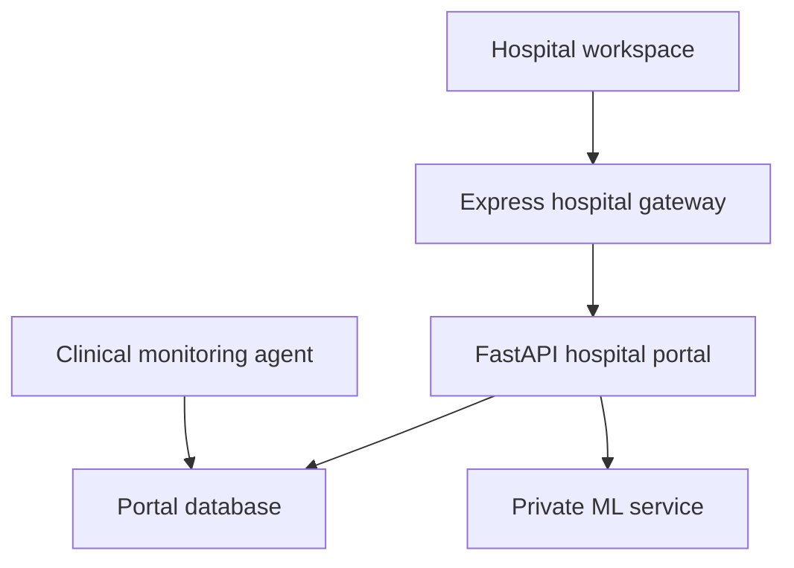

# Ultrasound AI Review

The hospital portal accepts single ultrasound frames from verified clinical staff and links each submission to the patient's recorded pregnancy. Consultants can review any consented patient in their active facility and unit. Residents can upload and inspect records for patients assigned to them. The consultant records the review decision and comments. This implementation uses the provider upload path.

The Kaggle archive failed the training audit. With the supplied configuration, the portal performs raster quality checks and provides manual image review. Archive scores appear only when an approved research artifact passes the model and dataset release checks. The review record is separate from diagnosis, confirmed risk, prescribing and treatment.

## Run the synthetic demo

From the repository root, install Node.js 22.13+ and Python 3.12. The launcher installs the project's dependencies, seeds the databases and starts the public gateway, hospital portal and private ML listener.

```sh
mkdir -p .local
umask 077
python3 - <<'PY' > .local/ultrasound-demo.env
import secrets
print("export DAI_ULTRASOUND_ENABLED=true")
print("export DAI_ULTRASOUND_IMAGE_KEY=" + secrets.token_hex(32))
print("export DAI_ULTRASOUND_SERVICE_TOKEN=" + secrets.token_urlsafe(48))
PY
. ./.local/ultrasound-demo.env
npm start
```

Create the environment file once per local dataset. Source the same file on later runs to keep existing encrypted images readable. Leave `DAI_ULTRASOUND_MODEL_DIR` unset for the no-model workflow.

1. Open `http://localhost:3001/hospital-admin`. Sign in using the local hospital admin demo account and displayed OTP. Use the **Demo role** selector to open a consultant workspace.
2. Open **Patient registry** and select an antenatal patient assigned to the current unit. On the patient record, choose **Upload for review** with a synthetic or authorized de-identified PNG, JPEG or WebP file, up to 12 MiB.
3. **Ultrasound AI Review** opens the linked record. Use **View ultrasound image**, then select a review decision, enter comments and save. The queue's **Reviewed by clinician** filter shows the saved review.
4. **Clinical monitoring** includes a linked ultrasound flag after its background sweep. Its recorded evidence can include episode-bound BP, glucose, trimester weights, finalized investigations and follow-up records. An image may appear in the Ultrasound queue before the monitoring sweep runs.

## Architecture and access



The portal uses existing hospital sessions, current affiliation, consent and unit assignments. Non-demo patient records require `care_coordination` and `clinical_monitoring` to be true. Synthetic legacy consent works in explicit demo mode. Image access is checked again on every read. PostgreSQL locks the parent record when an upload, retry or review is committed. SQLite uses its existing serialized write transactions. The image digest is unique within a mother, facility and pregnancy episode. Identical decoded submissions return the existing record, including after image expiration. A review uses the current analysis revision and returns 409 for stale or already reviewed submissions.

The portal verifies and decodes supported rasters, caps pixel count at 16 million, removes file metadata by re-encoding PNG, and stores only AES-256-GCM ciphertext in the existing database. The record UUID is authenticated as encryption context. Preview uses an authorized, non-cacheable binary response and a browser object URL. File names, tokens, image bytes and scores are excluded from application logs. The internal ML request carries sanitized image bytes and its service credential. It carries no patient or pregnancy identifiers. Raster checks do not establish whether an image depicts the intended anatomy or contains identifiers burned into the pixels. Remove burned-in identifiers before research upload.

The ML listener on `127.0.0.1:8200` serves all existing access-assistance routes and the authenticated ultrasound endpoint. The portal has an eight-second inference deadline. Unavailable inference leaves an image in the manual queue with a reason. Staff can retry while the image is retained, the record is pending and the previous attempt reported unavailable inference. Poor-quality images bypass prediction. Approved research outputs distinguish usable scores, low confidence and a priority review signal. Priority is for review, with 0.80 top-score and 0.30 combined non-Normal score thresholds for this research policy.

The agent reads the same approved scope through the consent-filtered monitoring scan. Each flag persists an upload ID and date, analysis revision, model version when available, reason, severity and review state. Related records are date- and episode-bounded and linked by original source ID. Their clinical priorities remain independent of experimental archive scores. A consultant review updates both the ultrasound record and any existing agent flag. Later scans preserve the clinician's review and respect consent and episode changes.

The default image lifetime is 30 days. Reads enforce expiration immediately. The portal's retention task clears expired ciphertext in batches while the feature is enabled. Approval comments and audit records follow the deployment's existing health-record retention policy. Set the image retention period before upload. Keep the key in a secret manager and apply matching retention to backups, exports and database snapshots. Restrict database and audit access, encrypt backups, and ensure proxy access logs do not retain identifiers or credentials. Demo authorization and simulated OTP are for synthetic data. See [deployment variables](.env.example).

## API

The public gateway prefixes the portal paths below with `/hospital-admin`. Portal calls require a valid hospital bearer token. A scoped miss returns 404. Invalid credentials return 401 and an unauthorized role receives 403.

| Method and portal path | Input and output |
| --- | --- |
| GET `/api/ultrasound/capability` | Whether intake is enabled for this deployment. |
| GET `/api/ultrasound?reviewed=false&offset=0` | Scope-checked queue, up to 25 rows per page, ordered by priority then time. |
| POST `/api/ultrasound/patients/{mother_id}` | Raw bytes with `image/png`, `image/jpeg` or `image/webp`. Returns 201 and an ID, or 200 with the existing ID for a duplicate. Unsupported MIME is 415, invalid rasters 422 and oversized data 413. |
| GET `/api/ultrasound/{id}` | Linked patient, pregnancy context, model/quality result, review reason and outcome. |
| GET `/api/ultrasound/{id}/image` | Private PNG with cache disabled. Expired images return 410. |
| POST `/api/ultrasound/{id}/retry` | Run inference again on a pending unavailable record. Updates its revision. |
| POST `/api/ultrasound/{id}/review` | JSON with `revision`, `decision` and `note`. Consultant permission required. Decisions are `review_complete`, `follow_up_needed` and `replacement_requested`. They record workflow disposition. |
| POST `/internal/ultrasound/analyze` | Private ML listener only. Separate service bearer token and sanitized PNG. Returns model state, quality measurements and optional research scores. |

The portable schema creates the table on portal startup. PostgreSQL operators can also apply [the SQL migration](migrations/20261123_ultrasound_analysis.sql) with `psql "$DATABASE_URL" -v ON_ERROR_STOP=1 -f hospital_portal/migrations/20261123_ultrasound_analysis.sql`.

## Tests

```sh
hospital_portal/.venv/bin/python -m pytest -q hospital_portal/tests
make ml-test
npm test --prefix backend
npm run typecheck --prefix hospital_portal/web
```

The separate browser test uses the running local demo and no configured ultrasound checkpoint. It creates and reviews two synthetic test uploads using a seeded consultant.

```sh
hospital_portal/.venv/bin/python -m pip install playwright
hospital_portal/.venv/bin/python -m playwright install chromium
hospital_portal/.venv/bin/python hospital_portal/tests/ultrasound_browser.py
```

Set `DAI_TEST_CHROMIUM` to use an existing Chromium executable. If the demo uses a custom port or state location, pass `--url` or `--db`.

## Model release and clinical evaluation

See [the training and audit guide](../ml-service/ultrasound/README.md) for dataset intake, independent splits, evaluation and model release. Before relying on scores in real care, establish a clinically meaningful target and reference standard, independently adjudicate labels, assess representative patients, scan views, devices and sites, and validate calibration, uncertainty, false negatives and workflow impact in an external cohort. Complete human factors, consent, security, operational monitoring and applicable governance review. [Good machine learning practice for medical device development](https://www.gov.uk/government/publications/good-machine-learning-practice-for-medical-device-development-guiding-principles/good-machine-learning-practice-for-medical-device-development-guiding-principles)
