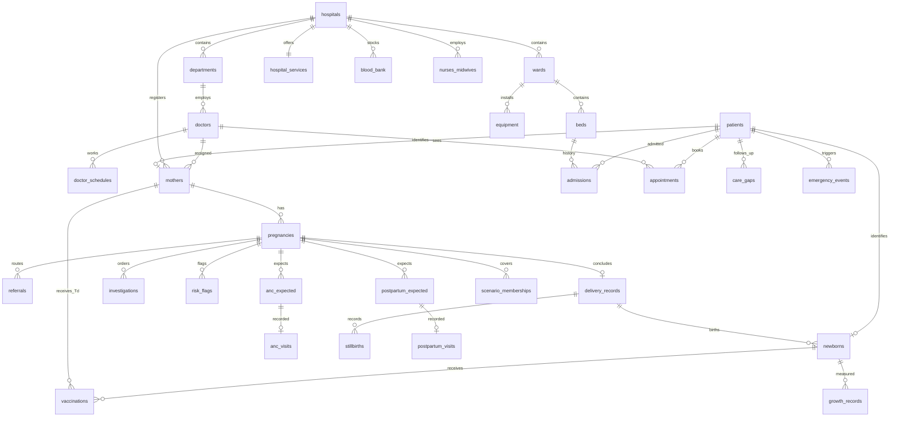

# DAI synthetic continuity dataset

**SYNTHETIC DATA ONLY.** Every person, facility, registration identifier and patient identifier is a deliberately labeled fictional fixture. Geographic district/state names are real reference categories. No real hospital or personal data source is used. This is a software-development dataset, not clinical guidance, an epidemiological estimate or proof of NMC compliance.

Python 3.11 is supported and was used for validation. Dependencies are pandas, NumPy and Faker; there are no paid APIs, model downloads or runtime network requests.

## Generate and validate

```sh
cd synthetic_data
python3.11 -m venv .venv
.venv/bin/pip install -r requirements.txt
.venv/bin/python generate.py
.venv/bin/python validate.py
# Overrides; config and effective CLI values are saved with the output.
.venv/bin/python generate.py --hospitals 12 --patients 5000 --seed 20261020
.venv/bin/python generate.py --hospitals 6 --patients 1000 --seed 42 --output output-small
.venv/bin/python generate.py --hospitals 24 --patients 10000 --output output-large
```

The default snapshot is **2026-10-20 at 12:00 local simulated time**. No host clock is used. Output is built in a sibling `.building` folder, validated, then promoted only after every rule passes. An unsuccessful run exits nonzero and retains its incomplete folder for diagnosis. An existing destination is replaced only after a successful generation. Choose a dedicated output directory, not a directory containing other work.

Every run produces:

- `csv/*.csv`: one UTF-8 table per file, with headers and blank NULLs.
- `dai.db`: SQLite tables with real PKs, FKs, CHECKs, unique indexes and FK enforcement during load.
- `schema.sql`: PostgreSQL-compatible CREATE TABLE/index statements; BOOLEANS, dates and timestamps retain native PostgreSQL types. Load CSVs in the order in `core.SPECS` (also the order in this DDL). CSVs contain True/False booleans that PostgreSQL accepts; use CSV HEADER with empty fields interpreted as NULL.
- `config.snapshot.json`: the exact effective configuration.
- `manifest.json`: table counts, scenario counts, edge-cohort counts and CSV SHA-256 values.
- `validation_report.json`: PASS/FAIL, number of checks, failures and examples for all 16 numbered rules plus coverage/format audits.

SQLite enforcement is connection-local. Every consuming connection must run `PRAGMA foreign_keys=ON` before writes. SQLite `PRAGMA foreign_key_check` is part of validation. The schema is separate from DaiHealth's application tables: this generator does not migrate or populate the application's database.

For reproducibility, keep the same config, seed, Python version and pinned dependencies. Stable ordering and IDs avoid timestamps/random UUIDs. The validator can be run offline against an exported database and compares CSV values, counts and hashes as well.

## Configuration

`config.yaml` uses **JSON-form YAML plus whole-line `#` comments**. This is valid YAML and is intentionally read by the standard-library JSON parser after removing comment lines, avoiding a PyYAML dependency. Keep object/list syntax when editing. All infrastructure quantities live in `msr_norms`, and prevalences, care probabilities, geography anchors, schedules and clinical value ranges have their own configurable blocks.

The default includes 12 facilities across Delhi (Delhi NCR), Uttar Pradesh, Bihar, Maharashtra, Tamil Nadu and Rajasthan. District anchors and small coordinate offsets keep points within the configured districts in India. Pincodes are prefix-consistent fictional six-digit values, not claims about valid delivery addresses. For arbitrary hospital counts the tier cycle repeats and geography cycles across six anchors. At least six hospitals are required.

The default 5,000 mothers include 480 seeded edge-case mothers (9.6%): 450 in thirty compatible scenario bundles and 30 additional rare-outcome seeds (MTP/molar). Scenario bundles repeat 15 times; multiple scenarios can apply to one person. Stage and normal-pregnancy coverage also use dedicated baseline examples. Baseline and oversampled counts are separately available in the manifest and scenario membership table. Twins are sampled at 1.3% and triplets+ at 0.05% in the remaining baseline; the validator allows sampling variation. Do not compute population prevalence without excluding `is_edge_case_seed`.

At least **615 mothers** are needed to retain all mandated coverage at 15 examples each. For smaller-than-default supported runs, the seeded edge fraction rises above 9%; the 15-example guarantee takes precedence. An undersized run is rejected with an explanation. Scaling up retains the configured 9% condition-seed target plus the rare-outcome seeds, and at least 15 examples of every scenario. Adjust hospital capacity/count as well as population for much larger runs: the allocator refuses to invent beds when resources are exhausted.

## Relationships



`patients` is a subject registry, not another unlinked population. Every mother and child ID is the registry PK; it permits enforceable foreign keys for polymorphic references such as a bed's current patient or a care gap's subject. Background inpatients are explicitly marked fixtures for the non-maternity hospital census. They make 60–95% whole-hospital occupancy possible without falsely assigning thousands of active beds to the cohort's outpatient mothers. Historical admissions use interval allocation; one patient and one bed cannot have overlapping admissions. NICU occupancy includes both historical neonatal admissions and the current synthetic census.

`stillbirths` is intentionally separate from live-born `newborns`. A delivered pregnancy has exactly `plurality_count` live-born plus stillborn records. Neonatal deaths remain live-born records with a death date. Miscarriage, ectopic, MTP and molar outcomes have no newborn/delivery rows; their outcome/date remain on pregnancy. All siblings have independent IDs, a common delivery and DOB, and unique birth order.

Referrals identify both facilities and clinicians, reason, timestamp and transport time. PHCs have a Medical Officer instead of a specialist; the mother's `assigned_obgyn_id` points to this primary clinician there. Higher-risk validation and delivery require explicit referral to a suitable centre. A confirmed high-risk flag needs a certified clinician at the registered or explicitly referred hospital. Raw rule flags may remain pending.

## Interpretation of requested rules and assumptions

1. **Phones:** a random Indian-shaped ten-digit number cannot be guaranteed never to belong to a real subscriber. The exported `phone` and `caregiver_contact` are **not dialable**: `9#########-SYNTHETIC-...`. `phone_numeric_core` is a format-only numeric fixture with no claim of an unassigned telecom range; never dial it. `contact_is_dialable=false` is enforced by validation. Names include SYNTHETIC and an ID suffix because an unmarked plausible Indian name can coincide with a real person.
2. **Date ordering:** birth-dose vaccines legitimately occur on DOB, and day-1/day-3 PNC can occur in hospital before discharge. Rule 4 checks these clinical exceptions explicitly; the first *post-discharge* PNC follows discharge. Future due dates and booked appointment dates are permitted; a planned Preconception LMP/EDD is also permitted. Current admissions have NULL discharge dates, rather than fabricated future discharges.
3. **Gestational age:** ongoing weeks use snapshot minus LMP. Concluded pregnancies freeze gestational age at outcome, while stage uses elapsed time since outcome. Preconception has week 0. The requested postpartum-stage vocabulary also describes post-loss recovery because it has no dedicated loss-recovery enum.
4. **Multiplicity:** DCDA/MCDA/MCMA describe twins. Triplets use TCTA and quadruplets QCQA rather than incorrectly assigning twin chorionicity to them. The baseline sampling rates are illustrative; referral patterns and edge-case proportions are intentionally artificial.
5. **UIP:** the schedule is encoded in config; 9/16-month doses use calendar-month arithmetic, not 30-day approximations. It includes fIPV-3 at nine months, PCV at six/fourteen weeks plus booster, maternal Td, and vitamin A (a supplement recorded alongside vaccination visits). JE is omitted because the configured district endemicity is not modeled. No PCV dose is invented at ten weeks. Future unadministered doses use `due` to mean scheduled because the requested enum has no `upcoming`. Doses after a child's death are retained as expected-schedule history, explicitly not applicable and excluded from care gaps.
6. **Clinical plausibility:** haemoglobin categories and BP/OGTT values are generated consistently with labels. These are simplified illustrative screening models. WHO-like z-scores are simulated, not computed using authoritative WHO LMS tables; do not use them to validate clinical growth algorithms. Likewise, positive screening markers are not fetal diagnoses. Actual diagnoses/treatments are outside scope.
7. **Care gaps:** expected ANC/PNC rows are generated from schedules; actual attendance, completed tests, vaccinations and flag validation are compared in pure code. No random care-gap rows are created. A late completion closes a previously detected gap. The validator reconstructs the expected schedule inventory so deleting expected rows along with gaps does not hide omissions.
8. **Emergency routing:** nearest means straight-line haversine distance among SOS-participating, 24x7 facilities with the required capability, not travel-time optimization. Response and referral transport times are synthetic distance-based estimates. Failed second authentication never allocates a bed.
9. **Messiness:** about 2.5% of mothers carry missing optional caregiver contact, late-entry metadata or similar-name tags; IDs, dates, FKs and mandatory fields remain coherent. Low literacy/income, greater distance and adolescent age increase missed-care probability.
10. **NMC verification:** every tier's total-bed range, ward weights and derived capacities, ICU/HDU ratio, NICU bed count, OT count, labour tables, equipment minima, occupancy range and staffing numbers are **VERIFY against NMC Minimum Standard Requirements (MSR) document** placeholders. NMC medical-college standards must not be treated as PHC/CHC norms. Verify the applicable current NMC notification, admissions/seats, department/unit size, staffing pyramid, equipment requirements and appropriate PHC/CHC/District IPHS standards before substituting exact numbers. Nothing here asserts an institution meets those standards.

Sources used as design references (not copied hospital data): [MoHFW Routine Immunization Manual for Health Workers](https://www.mohfw.gov.in/sites/default/files/Routine%20Immunization%20Manual%20For%20Health%20Workers.pdf), [NMC minimum requirements compendium](https://nmc.org.in/MCIRest/open/getDocument?path=%2FDocuments%2FPublic%2FPortal%2FE_Compendium_of_NMC_2024%2F8.+Minimum+standard+requirement.pdf). Schedules and clinical assumptions need professional verification for uses beyond synthetic fixtures.

## Tests and validation limits

```sh
.venv/bin/python test_rules.py --dataset output
```

The six tests cover calendar-month vaccination arithmetic, postpartum stages, SQL orphan rejection, rejection of double bed occupancy, late-care gap closure, haversine properties, and an adversarial export audit. The adversarial test deliberately alters Hb, deletes a derived gap, reduces doctor capacity and corrupts an SOS distance; validation must fail those checks and the CSV/database agreement check. The default dataset itself must pass every numbered rule and the two additional audits.

Each mother has one index pregnancy in this export. Gravida/para/living-children fields can describe prior history; those earlier pregnancies and children are not fabricated as if observed in this index cohort. Preterm children grow toward term-equivalent age before the illustrative growth reference is used. Z-scores are NULL before term-equivalent age, with `preterm_followup` instead of a spurious malnutrition classification.

The PostgreSQL DDL is standard compatible SQL; the available local PostgreSQL server could not initialize under the execution sandbox's shared-memory restrictions, so an actual PostgreSQL import was not verified here. SQLite imports, constraints, interval checks and all data audits were executed. With PostGIS installed, construct points as `ST_SetSRID(ST_MakePoint(longitude, latitude), 4326)`; longitude is the X coordinate.
